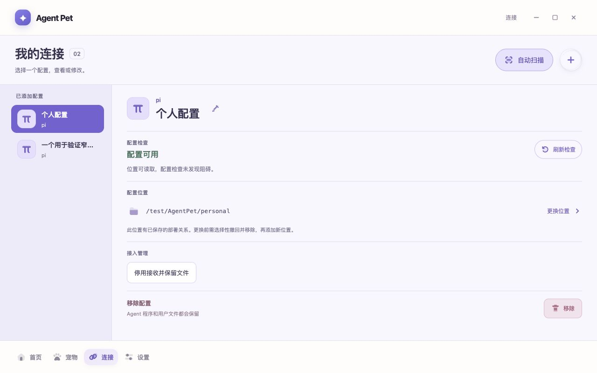

# 连接详情平铺修订（2026-10-15）

用户明确要求右侧去掉大卡片、减少浪费并由 subagent 批评优化。修改限于正式连接详情的内容排布与样式，Main、preload、连接/部署/撤回接口、共享外框和底栏均未修改。

## 改动与独立复核

独立 Product Test 首轮指出：居中700px限宽、右栏padding、大卡片、内部padding连续缩窄；紫底身份区重复强调；停用接收挂在配置位置下；粉色移除块又形成一层边界。

已移除 `cfg-detail-panel` DOM 和样式，取消详情限宽居中。右栏直接铺开名称、配置检查、配置位置、接入管理和移除，以细分隔线区分。图标48px、名称24px，编辑按钮靠近名称；路径使用普通可点击行；移除保留低强调危险按钮和数据保留说明。左栏由280px收至240px，中等宽度为208px；小窗保留既有列表→详情返回流程。没有把“配置可用”变成在线状态，也没有删除部署确认/取消或既有保护。

同一 subagent 独立复核宽、中、窄编辑、矮窗底部和预览截图：未发现确定的布局/使用阻塞。两张入场截图按其意见重拍，已核对普通详情计算opacity为1。错误态图的合成捕获仍受动画帧影响，已移除该图；错误文字/刷新恢复仅记为实际 DOM 操作验证，不用作对比度证据。

## 验证与截图

- `pnpm exec vitest run apps/desktop/src/renderer/management/ManagementApp.test.tsx`：既有28项通过，覆盖重命名、返回/取消、重复配置、部署预览及迟到请求等行为；未添加镜像样式测试、未删除或削弱任何保护测试。
- `pnpm typecheck`、`pnpm --filter @agent-pet/desktop build`、`pnpm package:mac`、diff检查通过。局部布局改动没有重复全量测试，不将历史结果写成本轮执行。
- 正式 Renderer/test bridge：1280×800 右栏 clientHeight/scrollHeight 都为548，无额外内容滚动；390px 文档宽390px、编辑输入宽350px；760×620 双栏可用。1000×480 通过 Tab 聚焦移除按钮并滚到底，scrollTop255、scrollHeight535、clientHeight276，外框与底栏保持固定。
- Escape 取消重命名、移除确认→取消、错误提示→刷新恢复、390px 预览→Shift+Tab 到取消→取消均实际执行；没有点击确认部署或移除。
- 实际新包以独立 `--user-data-dir` 启动，使用本轮自建 metadata/空目录，并展示平铺详情。该合成记录未具备正式接入的私有存储初始化，Main 按 saved-invalid 失败关闭；未部署、监听或读取日常 pi 目标。原生 AX 和一次实际画面确认了新层级和完整长路径；随后捕获失败（SCStream -3811），一次重新绑定/Raise恢复后滚动仍 noWindowsAvailable，按有界规则停止此路径。隔离进程77889已仅对自身发SIGTERM并确认退出，未改用其他UI协议继续操作。

以下均来自实际正式 Renderer 的隔离测试 bridge，使用合成路径；不是原型图，也不当作原生完整交互或真实连接验收：

- [中等宽度](screenshots/connection-detail-flat/renderer-medium.png)
- [窄窗长名称编辑](screenshots/connection-detail-flat/renderer-narrow-edit.png)
- [矮窗顶部](screenshots/connection-detail-flat/renderer-short.png)
- [矮窗键盘滚到底部](screenshots/connection-detail-flat/renderer-short-bottom.png)
- [窄窗预览取消](screenshots/connection-detail-flat/renderer-narrow-preview.png)

## 当前应用与边界

用户在此前排查后明确反馈 `/reload` 后首页已显示 pi；这是用户对本机在线结果的确认，不外推任务完成/错误矩阵或发布验收。

本轮保留 `/Users/gan/Desktop/🥷/Agent Pet.app` 的当前连接进程，没有退出、替换、重载它，也没有启动/重载用户 pi。新 arm64 本机包已生成于：

`/var/folders/sr/gztw7n8x7fncz4nmpgvbj3zc0000gn/T/agent-pet-m5-3Rj8PS/mac-arm64/Agent Pet.app`

源码和新版包已完成，当前运行版本尚未切换；切换时需正常退出旧 Agent Pet、替换并重开，再在连接页明确恢复已保存接收。原型认可、此次正式 UI 检查、用户实际在线反馈及发布验收保持各自范围。设置实机停点仍未完成，无新增依赖、Provider 或资产。

## 后续路径显示修订（2026-10-15）

用户明确要求此处配置路径不要换行。现在详情中的配置路径使用单行末尾省略，右侧“更换位置”保持完整；完整384字符测试路径保留在 DOM、原生 title 和按钮 aria-describedby 中。当前规则覆盖前文历史截图中的路径换行表现，不改变真实路径或提交参数。

正式 Renderer/test bridge 在390×844及1280×800实测：路径高度分别约19.2/20.8px，与单行行高相等；scrollWidth大于clientWidth并呈省略号，文档宽度等于窗口宽度，操作按钮完整可见。悬停提示通过完整title属性核对，未将其当原生系统tooltip的截图验收。既有28项管理页测试、typecheck和desktop build通过。此次增量没有重新打包，前述3Rj8PS包属于平铺布局阶段，尚不包含此路径修订；当前运行应用保持不变。

- [窄窗单行路径](screenshots/connection-detail-flat/renderer-path-ellipsis-narrow.png)
- [宽窗单行路径](screenshots/connection-detail-flat/renderer-path-ellipsis-wide.png)

## 后续修订：先看连接，文案说清下一步（2026-10-15）

用户反馈连接页文字过于专业、操作不好理解。本轮保留平铺详情、四页外框、单行路径及原有连接规则，调整信息顺序和连接相关页面/弹窗文案。

- 页面先显示真正的连接状态与下一步。“位置未检查”不再作为醒目警告或挤占左侧名称；位置检查默认收起，有检查问题时展开。检查文件夹可用不会把连接显示为在线。
- 主操作改为“重新连接”“继续连接”“暂停连接”。等待pi时说明打开pi或空闲时输入`/reload`；暂停不会关闭pi，连接文件保留。已暂停时不再重复显示暂停按钮。
- “监听、私有保存记录、部署关系、选择性撤回”等实现用语移出默认阅读内容，普通说明直接解释文件保留、是否影响pi和下一步。完整检查范围、文件权限、技术原因及重启限制仍可展开查看。
- 新文件仍须经过独立预览和“确认并连接”；精确路径、要创建的文件夹、不覆盖已有文件、不更改pi设置和不自动启动/重载仍明示。无法确认或被改动的文件仍受原Main规则保护。
- 已有连接文件的位置暂不能直接更换：按钮明确不可用，提示先移除此连接再添加新位置，路径正文保持可读。移除仍单独确认，解释只处理本产品连接文件及未知/改动文件保留，不删除Agent程序或用户文件。
- 打开预览后焦点进入标题，取消回到设置按钮；确认后回到连接状态。Main可能先推送取消结果、稍后返回操作结果，回焦会等按钮可用，隐藏页面和已卸载节点不抢焦点。

验证：全量`pnpm test` **691 passed / 1 skipped / 71 files**；`pnpm typecheck`和`pnpm package:mac`（含`pnpm --filter @agent-pet/desktop build`）通过。日志`/tmp/agent-pet-connection-friendly-{full-tests,package}.log`。单独相关39项与最终管理页32项曾分别通过，最终全量覆盖全部新增行为；没有更改或删除pi部署/撤回/数据保留/managed guard测试。

新增回归覆盖：保存的连接在未检查位置时仍显示重新连接、不会打开页面就恢复；接收等待/在线/未知与位置可用分别表达；暂停API仅作用于当前配置；独立写入确认、同名文件阻止；启动失败提供重启或移除的实际入口；过期预览只说明本次未新增，不否定已有文件；取消状态先推送、操作回复延迟时仍能回焦。原取消double已按真实行为清除当前ID的preview，未以修改断言掩盖错误。

独立Review发现启动失败“重试”缺实际入口、过期提示否定已有文件及取消回复延迟回焦三处问题，均修正并覆盖；最终只读Review READY，不冒充独立全量运行或真实pi验收。

Main亲自打开正式页面的隔离示例：1200×850待重新连接/等待pi/错误页；390×844详情入口、按钮、路径和默认折叠；1200×480内容滚动（scrollTop286.5，底部导航仍在431–475px）。位置检查后“位置可用”与“等待重新连接”保持独立；设置预览/取消实际AX确认焦点往返。384字符路径在390px下仍为nowrap+ellipsis，正文scrollWidth390，无页面横向溢出。示例路径均为`/test/AgentPet`，没有扫描或操作真实pi。

最新未签名arm64包：`/var/folders/sr/gztw7n8x7fncz4nmpgvbj3zc0000gn/T/agent-pet-m5-jjC0hq/mac-arm64/Agent Pet.app`。本轮只生成新包，没有替换或重启正在运行的应用，没有读写日常pi配置/凭据、部署、重载、依赖安装或推送。正式UI用户认可、真实接入、原生窗口层级及发布仍分别验收。
