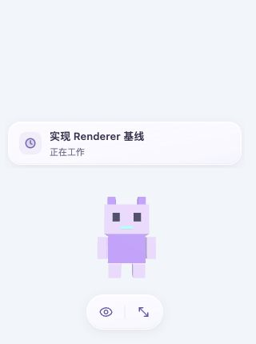
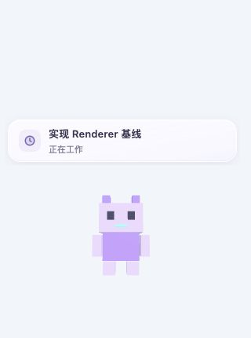
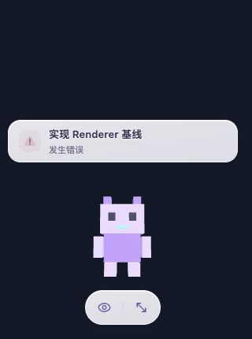
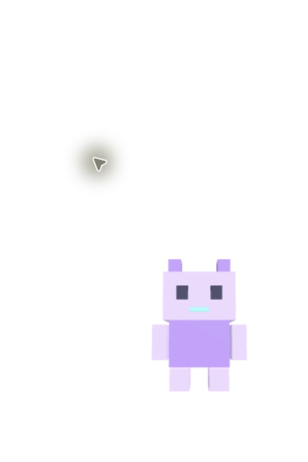

# 桌宠浮层修订证据（2026-10-15）

本轮覆盖桌面浮层外观、hover和macOS层级实现。正式管理页/原型不重新设计；用户当前pi连接不中断。状态：代码与隔离Renderer验证完成；原生跨应用/全屏层级、连续鼠标交接尚未验收，发布未验收。

## 行为与边界

- 桌面常驻宠物名称移除，设置不再提供无效名称开关。旧schema v2的`names`仍接受并保留，避免破坏已有偏好；管理页左上角名称编辑、收藏及首页聚焦信息不受影响。
- 气泡改为54px紧凑玻璃行，独立状态图标与两行文字；保留Session身份、工作/完成/错误、终态确认、Motion进入退出、堆叠/展开和提醒依赖。通知内文字是Session名称，不是已移除的宠物标签。
- 双操作条96×44px，两个36px目标，正常状态隐藏。实际R3F GLB命中触发；透明Canvas角和透明原生空域不会仅因window hover触发。保留180ms模型到工具条交接、键盘入口、拖动/缩放和气泡开关。
- 工具条先等待Main成功应用鼠标区域再显示；隐藏、失焦、隐藏后恢复、卸载和Renderer崩溃/重载会释放。旧Promise不能重开操作条，IPC失败保持隐藏，下次真实进入可恢复。App统一一个document visibility订阅供Canvas与工具条消费。
- Main仍是原生布局/命中权威。宠物的原生鼠标区域仍是Canvas矩形，未宣称逐像素原生穿透；这次缩小的是工具条出现条件和隐藏工具条占用区域。
- macOS改用Electron 36.9.5非激活`panel`，保留`screen-saver`级置顶、全工作区/fullscreen auxiliary和Dock，显示用`showInactive`，show/restore重应用当前偏好。关闭置顶不调用moveTop，没有抢焦点定时器。此前已有screen-saver级，不能把问题概括为“调高z-index”；普通应用遮挡的现场根因未证实。

Electron版本源码依据：[panel选项](https://github.com/electron/electron/blob/v36.9.5/docs/api/structures/base-window-options.md)、[macOS窗口与workspace实现](https://github.com/electron/electron/blob/v36.9.5/shell/browser/native_window_mac.mm)。依赖不变、未安装新包。

## 验证

- `pnpm test`：**682 passed / 1 skipped / 70 files**，最终日志`/tmp/agent-pet-overlay-tests.log`。原pi部署、撤回、unknown数据保留、managed guard测试仍通过；原skip未更改。
- `pnpm typecheck`：通过。
- `pnpm package:mac`：通过，内部执行`pnpm --filter @agent-pet/desktop build`。最终日志`/tmp/agent-pet-overlay-package.log`。包未签名，非正式发布。
- 红→绿：旧App仍显示“小伙伴”时名称回归失败，移除后通过；旧Main Electron double补齐isVisible/showInactive/moveTop后全入口回归通过。旧名称设置断言按新产品要求改为不存在。
- 新回归覆盖真实GLB中心/角落raycast、模型hover、透明Canvas不触发、隐藏工具条穿透、Main可信窗口/boolean校验、同步应用、重载清理、ACK迟到/拒绝恢复、窗口blur焦点、隐藏恢复、键盘再次进入、show/restore与topmost=false。
- 独立Review首次发现Main double遗漏、窗口blur及隐藏恢复旧状态，均已修正；最终独立54项/3文件通过，READY。独立Product Test查看新截图，无确定视觉阻塞；不替代实际鼠标/层级验收。

## 亲自运行与截图

正式Renderer测试入口`http://127.0.0.1:4175/visual.html?motion=working&theme=light`复用真实App、单R3F Canvas和starter.glb；只有Application观测数据和typed bridge在既有test-support边界替换，无真实pi或OS穿透模拟。

320×430实看：远处坐标和Canvas透明角工具条`data-visible=false`；点击真实模型后`true`；点击隐藏气泡后通知消失、按钮变为显示气泡。深色错误态另核对。没有将这些测试通知当真实pi证据。

实际原生包（同一Main/panel实现，最后隐藏恢复Renderer补丁前的阶段包）路径：`/var/folders/sr/gztw7n8x7fncz4nmpgvbj3zc0000gn/T/agent-pet-m5-CHDMwN/mac-arm64/Agent Pet.app`。新建独占profile `/var/folders/sr/gztw7n8x7fncz4nmpgvbj3zc0000gn/T/agent-pet-overlay-native-1txho8z3/profile`，仅非秘密preferences，清除pi相关环境变量，无配置/receiver/真实目标读取。原生AX确认包内index.html、气泡开关与调整大小，实际GLB和无名称画面通过。菜单正常退出，PID94996已退出，原稳定应用仍运行。

原生坐标首个操作发生windowNotFoundAtPosition；一次重新绑定+Raise恢复后坐标操作完成，但画面不能证明模型到工具条交接。按AGENTS停该路径，不切换协议或无限重试。窗口单独截图不能证明位于另一应用或全屏Space之上；这些项目仍需实际验收，不能标PASS。

## 最终运行入口

最终含隐藏恢复修复的新包：

`/var/folders/sr/gztw7n8x7fncz4nmpgvbj3zc0000gn/T/agent-pet-m5-SEqavc/mac-arm64/Agent Pet.app`

未替换、退出或重启当前`/Users/gan/Desktop/🥷/Agent Pet.app`，保持其pi接收。打开新包不会强制替代已有单实例；日常运行切换与已保存接收恢复应另按现有明确范围操作。未访问pi设置/凭据/会话、未部署或reload pi、未改系统登录项。正式UI用户反馈、完整OS窗口矩阵和发布验收仍独立记录。
