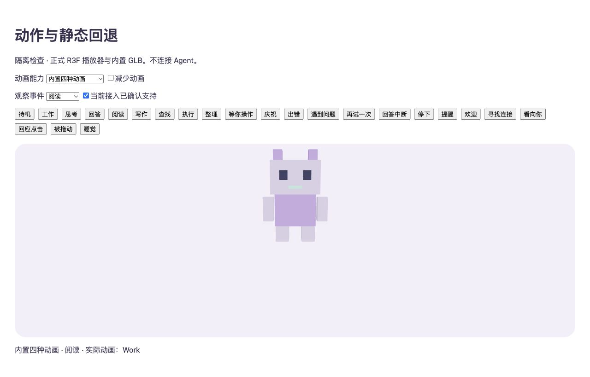
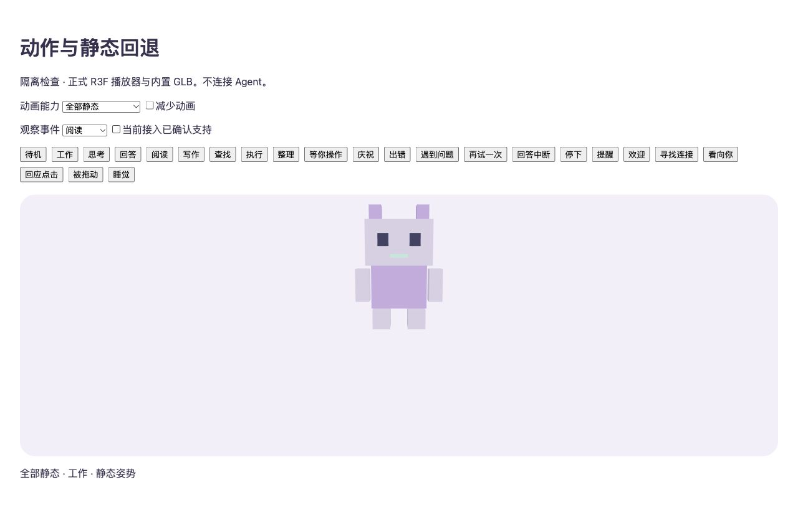

# 可选动作与 pi 细分事件（2026-10-15）

用户授权先做“全部动作可选、静态回退、统一目录”，随后接 pi 细分事件；继续 dev，不打包。本轮代码与隔离验证完成，真实 pi 新扩展加载及发布未验收。

## 已完成

| 行为 | 实现位置 | 验证 |
| --- | --- | --- |
| 23种统一动作、全部可选（含待机） | pet-runtime/actions、manifest validator | 缺项/null/坏值/无clip/未来目录版本；艺术家模板由唯一目录生成 |
| 桌宠、首页、试播共用播放器 | shared/usePetAnimation、PetModel、ScenePet | 实际GLB/Three混合器；零clip静态、默认姿势恢复、单次结束、严格模式、卸载与缓存资源 |
| 统一的事件到动作选择 | domain/companion、pet-runtime/presentation | 能力未知/不支持不当作待机；工作、未读结果独立；首页按配置筛选同一快照 |
| pi细分事件 | 自包含pi扩展、严格bridge协议与mapper | 真实隔离socket → Adapter → Application → 正式动作投影；生成扩展在无环境子进程中加载 |
| 断开/重连/停止 | PiBridgeAdapter、domain baseline | 清活动、不清已有未读；新Application不回放历史；旧peer关闭不能压过新hello；stop重入及发布抛错均释放socket；Main先失效epoch再本地清理，过滤重叠重连的旧peer，清理失败可重试 |
| 单次反馈身份 | presentation replay、Renderer内有界cue记忆 | 重命名、等待结束、断开、切页/场景重挂不重播；新work和数值主动试播可重播 |

动作目录与可填写格式见 [艺术家说明](PET-ARTIST-GUIDE.md)。现有内置模型仍只有 Idle/Work/Success/Error 四条动画；新增事件会按规则使用已有动作或静态显示，本轮没有创作额外动画或开放外部资产导入。

## pi 当前可观察范围

| 原生事件 | 统一事实/表达 | 限制 |
| --- | --- | --- |
| message_update 的 thinking/text start/end | 思考、回答 | 只读取类别和有界内容索引，不读取delta、partial或正文 |
| tool_execution_start/end | 阅读、写作、查找、执行 | 固定工具名分类；并行按toolCallId跟踪；未知工具保持粗略工作；不传工具名/ID/参数/结果 |
| 工具isError | 一次“遇到问题” | 不升级为任务失败，结束后恢复当前活动；无对应动画则继续工作 |
| ui_prompt_start/end | 等你操作 | 仅pi扩展UI提示，不代表所有权限/信任/原生输入等待 |
| session_before_compact、session_compact/failed、AbortSignal | 整理上下文及结束 | 保留原基础状态；取消整理不等于取消任务；旧signal在切换/结束时解绑 |
| message_end stopReason + agent_settled/isIdle | 完成、任务出错、取消、回答中断 | 只在整批settled后结束；连续agent_start保留同一work身份，避免中途报完成 |
| session_start/info_changed/shutdown | 名称、当前基线、连接生命周期 | 重连不回放旧单次反馈；不启动/重载/控制pi |

依据 pi 0.85.1 Extension API。运行时没有读取/猜测pi版本：细分能力初始为 `unknown`，只有真正收到对应事件才升为 `supported`，与当前连接的快照一起传递；注册hook不算支持证据。自动重试的开始/结束不在该Extension API事件集合中，保持未知，不根据延迟或文本猜测。目录中的欢迎、寻找连接、hover、拖动、睡觉等并不等于此次已接好触发。

`SessionStatus`仍描述工作生命周期；`CompanionFacts`只含有界活动枚举、等待布尔和单次事件ID/类别，`ObservationCapabilities`区分支持/不支持/未知。桥协议schema仍为1，新增可选能力/事实及companion消息，旧扩展继续提供粗略状态。未知字段、正文、重复/超量活动、非法枚举、事件ID和序号均拒绝。新扩展不能发给旧版本接收器并期待细分兼容；本轮验证的是旧扩展 → 新接收器兼容。

双槽revision仅用于启用断开清理的本机legacy receiver（wire seq×2，断开+1；序号有安全整数上限），默认mapper与managed路径保留原revision。managed服务、授权/撤回guard和生产延期门槛未改变；没有为managed新增部署或断开清理策略。

## 验证与运行

- 阶段1：全量705通过、1跳过/72文件；独立复验76项。
- 阶段2：最终全量736通过、1跳过/74文件。独立重点复验86项、Main最终修正另复验31项，无确定阻塞。
- 两阶段 `pnpm typecheck`、`pnpm --filter @agent-pet/desktop build`、`node scripts/generate-pet-templates.mjs --check`、diff检查通过。build只编译，没有package:mac/electron-builder或依赖安装。原有部署、撤回、保留数据与managed失败关闭测试保留；跳过项不是通过。
- 实际Electron dev使用独立测试profile与localhost:5174，管理首页空态启动正常，原生AX确认可进入宠物页及看到试播入口；动作盘点击未可靠生效，截图恢复后仍出现ScreenCaptureKit -3811。不声称完整原生交互通过。
- 4175测试边界亲自操作正式ScenePet/真实GLB，检查阅读→Work回退、能力未知→粗略工作、全部无映射→静态；未用原型组件冒充。可运行 `pnpm demo:connections` 后打开 `/pet-actions-review.html`，也可直接访问已运行的 [检查页](http://127.0.0.1:4175/pet-actions-review.html)。该页只有隔离示例，没有Agent/文件/IPC入口。

没有读取/修改日常pi配置、部署新扩展、启动/重载pi或发模型请求。已在运行的旧扩展不会因源码修改自动更新；当前真实pi仍按原粗略事件工作。后续若要实机验收细分事件，需要对更新那一份扩展的准确范围另给预览并获授权。其他Provider、完整资产导入、真实TUI细分任务矩阵与正式发布不在本次通过范围。
