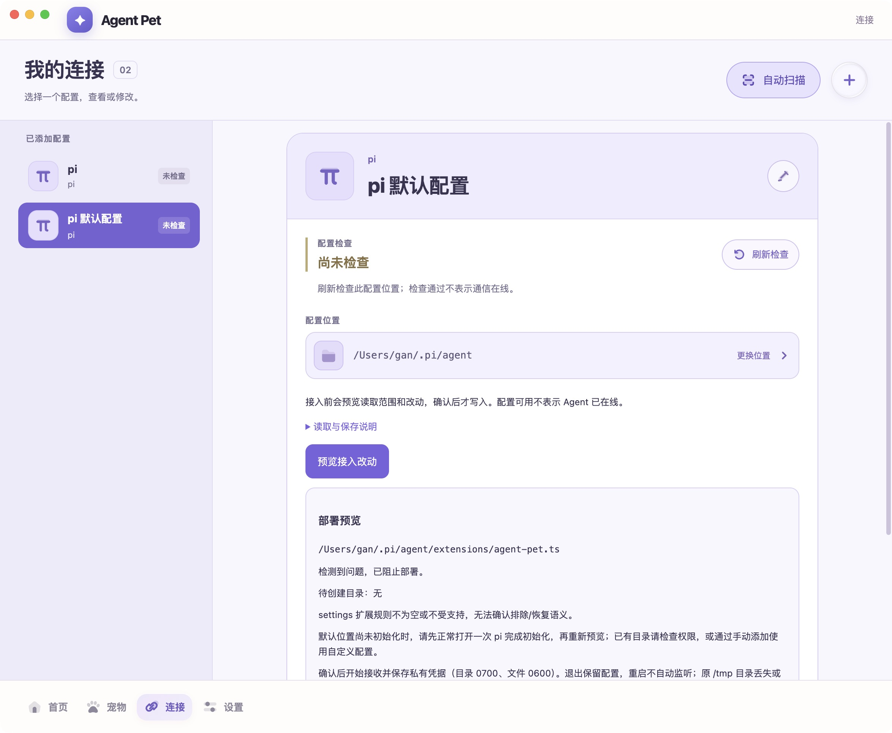

# pi 自动扫描到一键配置 · 2026-10-15

用户纠正正式扫描后的流程：扫描结果应直接配置，不应再要求选配置目录。此前正式实现只找程序，当前增量让已支持 pi 的默认配置成为直接入口；手动流程继续用于项目和自定义位置。

## 正式行为与边界

- Main 根据自身 HOME 匹配 `.pi/agent`，发现两份支持的 pi 程序但共用默认目标时，Renderer 展示一个“pi 默认配置”和一个“一键配置”按钮。安装路径放在详情里；只按相同配置目标合并，不按 Agent 类型合并独立配置。
- 一键操作自动填写类型、默认名称与位置。Main 接受最新扫描的 opaque ID，不接受 Renderer 路径或伪造的兼容性；先显示精确默认路径和只读检查范围的原生确认，用户不需要选择目录或类型。
- 同意检查后，Main 重新识别安装 metadata，canonicalize 已批准目标，再保存非秘密配置并直接准备既有部署预览。实际扩展写入、私有接收凭据与监听仍由用户独立确认的既有 `PiConnection.confirm` 执行。未部署不显示在线；原生检查取消不新增记录；预览取消保留已保存的未连接记录供重试，不创建扩展。
- 已有相同配置直接“查看配置”，不重复添加或自动恢复监听。未知版本不提供一键配置。默认父目录未初始化时维持既有阻止，提示先正常打开 pi 或手动添加；不扩大 mkdir 层级、不修权限或替换未知文件。
- close、reload、渲染进程退出与窗口隐藏保护待处理批准；重新扫描使旧 candidate ID 失效。返回列表后的迟到结果撤销预览，不跳回详情。跨页面仍消费同一管理状态源。
- 当前仅支持标准 pi 默认位置。不会读取 shell profile 来猜测自定义 `PI_CODING_AGENT_DIR`，不递归寻找项目；不新增 Provider，不改 managed guard、receipt 或撤回契约。

## 验证

全量 `pnpm test`：**665 passed / 1 skipped / 67 files**；`pnpm typecheck`、`pnpm --filter @agent-pet/desktop build` 通过。独立只读审查 READY，**80 项 / 6 文件** 通过；审查指出的返回迟到竞争及默认目录恢复文案均已修复。随后增加首次扫描即不支持版本的 Main/Renderer 直接回归，包含于最终全量结果。

隔离 Main IPC 测试使用自建 HOME/NVM metadata、真实文件和私有 store、替代 Adapter：验证无目录选择器、检查批准范围、创建预览前无写入/监听、取消、重复、确认后才部署、选择性撤回、保存失败、安装变化、陈旧ID、并发、close/hide/rescan、preview 期间失效和父目录未初始化。Renderer 测试覆盖多安装单入口、跳过手动向导、部署未自动确认、取消/错误重试、已有配置查看和返回不被迟到结果接管。Adapter double 不算真实 pi 接入验收；既有真实 socket、数据保留和 managed 测试保持。

日志：`/tmp/agent-pet-auto-config-{tests-final,types-final,build,package}.log`。原型认可、正式 UI 验证、真实 pi 接入、发布验收仍各自计量；此轮代码未授权自动读取或部署日常 `.pi` 目标。

## 正式应用实机观察

最终未签名 arm64 包已构建成功并替换稳定入口 `/Users/gan/Desktop/🥷/Agent Pet.app`。旧版正常退出，旧包可从 `/Users/gan/.Trash/AgentPet-auto-config-backup-20261015-a3040f34/previous-Agent Pet.app` 恢复，旧数据/profile 保留；历史 fixtures 未清理。

Main 亲自打开实际 `app.asar/out/renderer/management.html`，在已授权的只读安装扫描范围内再次扫描。两处安装合为一个“pi 默认配置 / /Users/gan/.pi/agent”，仅一个“一键配置”，不再显示“选择配置位置”。点击后直接显示精确读取确认，无目录选择器或手动向导。

原生工具点击取消后，界面持续显示 busy；一次正常重启及键盘取消复核期间工具通知用户更改了应用，因此该原生取消路径结果不确定，不计入已通过。没有继续尝试点击批准或部署。随后只读观察当前正式页：新默认配置已保存，并有 `settings-unknown` 的 blocked 部署预览，确认部署禁用；没有扩展写入或监听的成功证据。该变化发生于工具通知用户接手之后，不把它归为 Agent 完成日常配置读取/接入验收。未进一步操作或读取日常文件正文。

原生页面证明已跳过选目录并走到真实预览，也证明当前日常配置仍受既有扩展规则保护而未连通。该默认记录和旧测试记录保留；不清理或绕过 settings/ignore/trust。实际截图来自正式包，紫色捕获提示为工具叠层。

