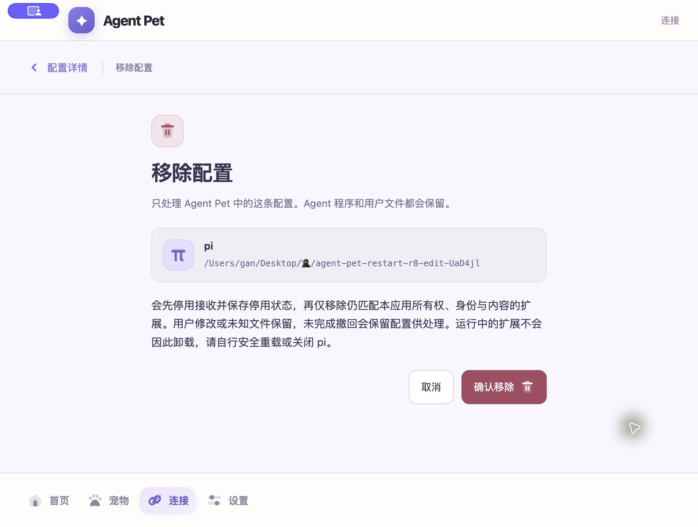
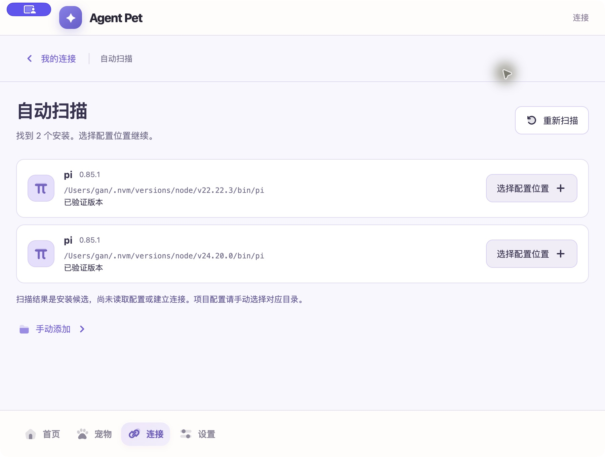

# pi 扫描与失效配置移除修复 · 2026-10-14

当前用户报告的固定 pi 是自身 profile 中恢复的历史部署记录；正式原生页面显示位置为 `/Users/gan/Desktop/🥷/agent-pet-restart-r8-edit-UaD4jl`，检查结果为配置目录不存在。它不是新 Provider、演示数据或当前真实在线 pi。此轮修复代码，不自动删除该历史记录或历史目标。

## 修复行为

- Finder 不继承交互 shell 的 NVM PATH。Main 扫描固定 HOME 下 `.nvm/versions/node` 一层目录，最多检查 64 项、16 个最新版本，合并 GUI PATH 与既有固定位置后最多 51 候选。共享 3 秒/4096 操作预算，取消、目录变化、越界或读取失败标为 limited，正式 UI 显示重试/手动选择。
- 只读取目录和安装 metadata、符号链接与 CLI 类型；不执行 CLI、不加载 shell profile、不递归找项目、不读取日常配置、Session 或凭据。支持范围仍为已有 pi 身份/0.85.1；安装候选不等于部署或通信在线。
- 私有有效 receipt 的扩展已明确缺失时，撤回返回 `already-absent`。先停用接收并保存 disabled，再清除私有保存记录和产品配置。目标目录和未知内容保留；运行中的扩展不宣称卸载。自建空 runtime 仍按既有身份检查释放。
- 文件编辑/替换、符号链接、权限错误、无有效 receipt 和保存失败继续失败关闭；不借此认领文件、修复权限或放宽 managed guard。

## 自动验证与真实安装范围

初始 red：原实现 **4 failed / 68 passed**，分别复现 Finder NVM 漏扫、缺失文件/目标误判以及 legacy 删除失败。修复后 focused **108 passed / 5 files**，全量 **652 passed / 1 skipped / 67 files**，`pnpm typecheck`、`pnpm --filter @agent-pet/desktop build`、`pnpm package:mac` 通过。独立只读 Review **READY**，110 项/6 文件复验通过。审查文案修订后正式 UI focused **28 passed / 2 files**，最终 package 内再次构建通过。

隔离真实文件系统覆盖版本/目录项超限、满 GUI PATH 不截断 NVM、预算取消、不执行 CLI、unsafe/symlink、缺失目标仅清产品记录、无权限保留、保存失败以及重新创建 controller/store 后旧记录不复活。既有部署、变更文件保留、撤回和 managed 测试未删除。

按此前授权，只对精确 `/Users/gan/.nvm/versions/node/v22.22.3/bin/pi` 安装运行本轮 Main 的 metadata 识别函数，实际结果 `0.85.1 / verified-0.85.1`；没有运行 pi。这不是本轮完整 HOME 扫描或日常连接验收。新版原生扫描的扩大只读范围另行提出具体授权；未授权前不自动点击。

## 正式运行入口

最终未签名 arm64 包更新到 `/Users/gan/Desktop/🥷/Agent Pet.app`，保留原 profile。旧包正常退出并保存到 Trash 的 `AgentPet-discovery-fix-backup-20261014-15e867f0/previous-Agent Pet.app`，可恢复；中间打包输出也可恢复归档。源码、日常 pi 数据、历史 native fixture 与旧目标均未清理。原型认可、正式 UI 验证、授权隔离 pi 生命周期和发布验收保持各自范围；发布/完整 D6 仍未通过。

Main 亲自从稳定路径启动最终包，原生 AX 确认实际 `app.asar/out/renderer/management.html`、首页空态、连接中的历史配置、移除预览、确认/取消按钮。实际点击取消返回详情，记录仍在；没有点击确认移除、恢复接收、刷新目标或扫描。实际正式截图如下，左上紫色捕获提示是工具叠层，不是产品控件。

日志：`/tmp/agent-pet-discovery-removal-{focused,tests,types,build,ui-final,package-final}.log`；初始红测试为 `...-red.log`。本阶段不推送。

## 本机扫描实测 · 2026-10-15

用户明确授权新版应用的只读扫描：当前 GUI PATH、`/opt/homebrew/bin/pi`、`/usr/local/bin/pi`、`/Users/gan/.local/bin/pi` 和 `/Users/gan/.nvm/versions/node` 一层（最多 64 项/16 版本），仅核对链接和安装元数据。不执行 pi、不读日常 `.pi` 配置或凭据、不部署。该授权覆盖上文此前尚待确认的扫描范围，不扩展到配置选择、旧记录移除或连接恢复。

Main 亲自操作稳定路径 `/Users/gan/Desktop/🥷/Agent Pet.app` 的正式管理窗口，点击一次“自动扫描”。实际 `file:.../app.asar/out/renderer/management.html` 的原生 AX 和截图均显示“找到 2 个安装”，以下两条均为 `pi 0.85.1 / 已验证版本`：

- `/Users/gan/.nvm/versions/node/v22.22.3/bin/pi`
- `/Users/gan/.nvm/versions/node/v24.20.0/bin/pi`

页面没有受限提示或扫描错误，仍显示“扫描结果是安装候选，尚未读取配置或建立连接”。没有点击选择配置、手动添加、重新扫描、部署、恢复或移除；应用留在扫描结果页。此次确认正式包能够发现本机 NVM 安装；不外推为日常 pi 接入或任务矩阵通过。当前旧测试记录继续保留。

首次截图返回 ScreenCaptureKit `-3811`；按有界恢复规则重新绑定同一应用后截图成功。左上紫色图标为捕获提示。此轮没有修改实现代码，无需重复构建或自动化测试；检查文档 diff 和截图后提交验收证据，不推送。

