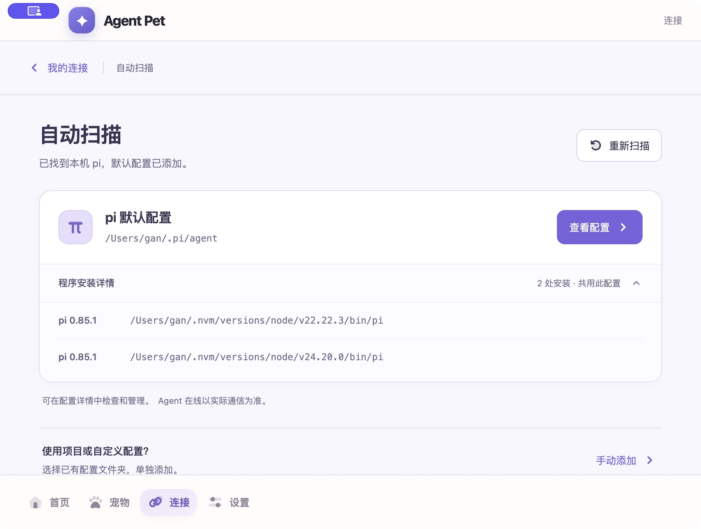
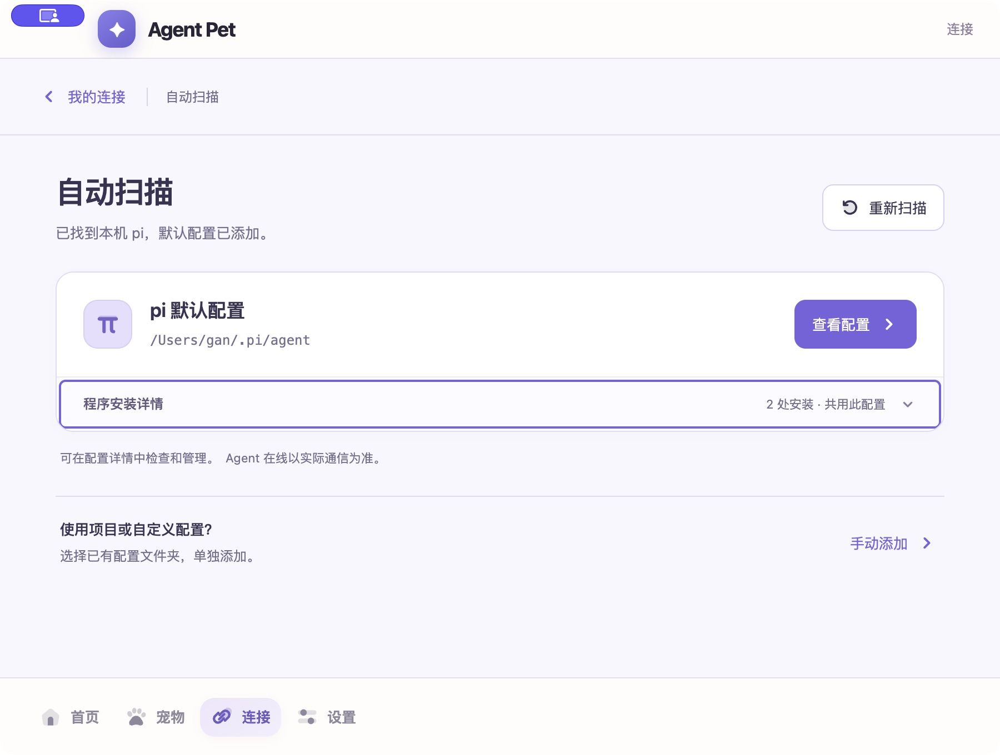

# 自动扫描结果视觉修订（2026-10-15）

用户要求独立 subagent 批评截图后优化正式页面。范围只涉及扫描页结构、样式、状态文案和测试边界，不改共享外框/导航、Main/preload 或接入权限。

## 修改与独立判断

独立 Product Test 的首轮 P1：详情位于同一个居中 flex 行，展开后图标/主操作落在安装列表中部；窄窗三列挤压路径。P2：原生 disclosure 缺少层级，已添加状态仍引导新建，长说明占据过多注意力。

已拆为配置头部与独立安装证据区。主按钮固定属于配置；48px 原生 summary、统一箭头、分隔记录、完整路径换行；600px 以下主操作独占整行。说明按新建/已有配置区分；手动添加放入独立次级入口。依然按默认目标合并安装，不新增成功状态、不把保存记录当成在线。

同一 subagent 复核正式 Renderer 宽/窄截图、源码 diff 和实际原生截图：未发现必须修正项。其判断覆盖截图与源码；键盘/点击由 Main 实际执行，没有声称独立读屏验证或系统权限隔离。

## 验证

- `pnpm exec vitest run apps/desktop/src/renderer/management/ManagementApp.test.tsx`：28 项通过。覆盖详情收起/展开、只生成一个默认配置入口、根据已有配置切换文案、独立授权、取消及迟到请求等既有行为。未弱化部署、撤回、保留或失败关闭测试。
- `pnpm typecheck`、`pnpm --filter @agent-pet/desktop build`、`pnpm package:mac`：通过。本轮为局部 Renderer 修订，未重复运行上阶段的全量 671 项；不将上阶段测试结果冒充本轮全量结果。
- 测试中最初以键盘触发 details 的断言在 jsdom 不支持该原生默认行为；一次有界修正改为点击验证，键盘在真实浏览器/原生应用验证，未添加特殊生产键盘逻辑。
- 正式 Renderer/test bridge：1280×800、390×844、1000×480；Enter 展开、Space 收起、长路径、手动弹窗打开/关闭及焦点回归、新配置授权弹窗取消均通过。390px 文档宽度为390px，没有横向溢出；矮窗内容区可滚动至手动入口。测试 doubles 仅在既有 `test-support` 中。
- 实际本地 `.app` 正常更新启动，当前用户 profile，900×680 管理窗口；按此前精确授权范围只读自动扫描，显示两份 pi 0.85.1、一条默认配置及“查看配置”。实际点击展开、空格收起与 AX 记录一致。AX 一次未及时更新、坐标操作返回 noWindowsAvailable；重新绑定后 Raise 的一次有界恢复成功，继续取得新页面 AX 和截图，没有切换自动化协议。

## 截图与运行入口

实际应用：`/Users/gan/Desktop/🥷/Agent Pet.app`，打开管理窗口 → 连接 → 自动扫描。旧包可恢复保存在 `/Users/gan/.Trash/AgentPet-scan-visual-backup-20261015-0c464b96/previous-Agent Pet.app`。当前为未签名本机 arm64 包，非发布验收。

实际 Electron（左上紫色系统捕获指示不属于产品界面）：

正式 Renderer，合成安装路径的隔离 bridge；不构成真实 pi 接入证据：

- [宽窗展开](screenshots/pi-scan-refinement/renderer-wide-expanded.png)
- [窄窗展开](screenshots/pi-scan-refinement/renderer-narrow-expanded.png)
- [矮窗滚动](screenshots/pi-scan-refinement/renderer-short-expanded.png)
- [新配置入口](screenshots/pi-scan-refinement/renderer-new.png)

原型认可保持原范围；正式页面视觉已检查、用户正式 UI 验收待反馈。本轮没有日常配置检查或扩展写入，没有启动/重载 pi，不代表真实通信、模型任务或发布验收通过。保留用户“只更新修复，暂不部署”的选择，原设置实机停点仍未完成。
